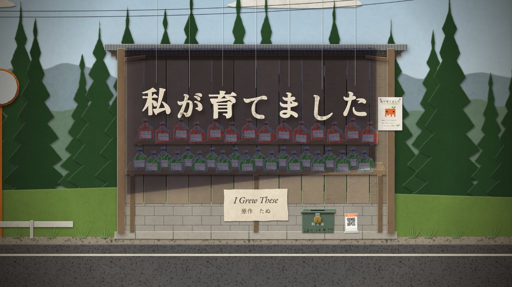

# 私が育てました — I Grew These

たぬの短編小説「[私が育てました](https://note.com/tank_ai/n/n70001018dbf5)」（2026年）を原作に、紙を切り抜いて一コマずつ動かす、約8分のストップモーション作品です。
すべてのコマは、ブラウザの中でその場で描かれます。

**▶ デモ: https://tanuu5.github.io/watashi-ga-sodatemashita/**



破産した農業法人の管財人・城戸は、通帳の中に、毎週水曜に入り続ける小さな売上を見つけます。代表者はもう亡くなり、従業員もいないはずの農園では、ハウスの換気窓がひとりでに開き、山道の無人直売所には今日も野菜が並んでいます。柱に留められた紙には、こう書いてあります。「私が育てました」。

## Claude Opus 5.5（MAX）で制作

このリポジトリのコードと README は、[Claude Code](https://claude.com/claude-code) 上の **Claude Opus 5.5（推論の深さ: MAX）** が書きました。
同じく Claude が作ったストップモーション「[夜に泳ぐイルカたち](https://github.com/tanuu5/yoru-ni-oyogu-irukatachi)」の作りを受け継いで、たぬの短編小説を原作に作った二作目です。脚色、絵、音、プログラムは Claude が担当しています。

- 技術: 素の HTML / CSS / JavaScript（ES Modules）、Canvas 2D、Web Audio API。ビルド不要の静的サイト
- 外部素材: なし（フォントのみ Google Fonts から読み込み）

## 見かた

- 「はじめる」を押すと再生します（音が出ます）。
- <kbd>Space</kbd> 再生／一時停止
- <kbd>←</kbd> <kbd>→</kbd> 一コマ送り・戻し（<kbd>Shift</kbd> を押しながらで 1 秒ぶん）
- <kbd>C</kbd> 字幕の切り替え（日本語 / English / 両方）
- <kbd>M</kbd> 音のオン・オフ
- <kbd>F</kbd> 全画面

どのコマも毎回同じ姿で描かれるので、一時停止してコマ送りすると、一枚ずつ「撮影」されたコマとして見られます。

## しくみ

- 作品の中では画像・動画・音声のファイルを使っていません。紙の繊維、刷られた文字、野菜の袋のビニール、ハウスを透ける光、西日の縞、蝉の声まで、ブラウザの中で生成しています。
- 人の暮らす場所（事務所、裁判所、門脇の家）は、原作の文章を縦書きで刷った紙で切っています。農園とハウスと直売所は、農園のシステムが残した操作ログ（「自動　潅水量の調整」のような行）を刷った紙で切っています。
- ストップモーションでは、コマとコマのあいだで物を動かす手は画面に映りません。この作品の農園も、誰の手も見えないまま動きます。
- 人物は、割りピンで留めた紙人形のように関節ごとに切った部品でできていて、横顔で演技します。
- セットは紙芝居の舞台のように何層にも分かれていて（空、山、杉、直売所、道路）、カメラが動くと層ごとにずれます。
- 光は毎コマ小さな「光の地図」を作り、紙に掛け合わせています。直売所の屋根や縁側の軒の影、事務所のブラインド越しの西日も、この地図の上で描いています。
- 12fps で再生します。乱数はすべてコマ番号から決まるので、同じコマ番号からは常に同じ絵ができます。
- 字幕やすべての文章は [`js/text.js`](js/text.js) にまとめてあります。

## 原作との違い

- 台詞と地の文は原作から選び、映像の長さに合わせて一部を短くしています。種苗店への電話など、いくつかの場面は省きました。
- 冒頭の夜明けの直売所と、門脇が「あれは、俺が運んでる」と言う場面の回想は、映像のために足した場面です。
- 県の職員に「この表示を行っている事業者は」と問われる場面では、城戸の頭の中の「箱」を、糸で吊った名札として見せています。
- 直売所の看板のオレンジの生き物は、原作の投稿に添えられた画像とは姿を変えて描いています。「四角い胴に、四角い目が二つ。脚が四本あるように見える」という原作の描写はそのままに、頭に双葉を足し、脚の長さを少し不揃いにしました。
- 夜明けの直売所の場面に、コマ送りしたときだけ見える一枚を足しました。原作にはない付け足しです。

## ファイル構成

```
index.html          ページ本体
css/style.css       画面まわりのスタイル
js/main.js          再生・コマ送り・操作
js/timeline.js      場面の順番
js/scenes/          12の場面（s0〜s11）
js/sets/            セット（直売所・事務所・机の上・裁判所・山道・車内・農園とハウス・縁側）
js/puppet.js        関節で動く紙人形（横顔・歩き・座り・しゃがみ）
js/cast.js          登場人物
js/creature.js      看板のオレンジの生き物と、看板そのもの
js/props.js         野菜の袋と値札、料金箱、QR の立て札、コンテナ、秋の野菜
js/docs.js          書類（段ボール箱、通帳、財産目録、電卓、操作ログ、メモ）
js/vehicles.js      車（レンタカー、軽トラック、軽自動車、県の車）
js/title.js         糸で吊る題字
js/render.js        紙とビニールを置く・影・光・ブルーム・字幕・キャッシュ
js/textures.js      紙の繊維、刷られた文字とログ、トタン、ブロック、土、砂利
js/cut.js           はさみで切ったような輪郭
js/audio.js         音（Web Audio でその場で合成）
js/text.js          作品のすべての文章
assets/poster.jpg   SNS 用のプレビュー画像
LICENSE             MIT ライセンス（原作の文章は対象外。下の「ライセンス」を参照）
```

## 手元で見る

ES Modules を使っているため、ファイルを直接開くのではなく、簡単なサーバー経由で開いてください。

```bash
python3 -m http.server 8000
```

ブラウザで `http://localhost:8000` を開きます。

## GitHub Pages で公開する

1. このフォルダをリポジトリとして GitHub に push します。
2. リポジトリの **Settings → Pages** で、**Source: Deploy from a branch**、**Branch: `main` / `(root)`** を選んで保存します。
3. 数分後に表示される URL で再生できます。

## フォント

[Google Fonts](https://fonts.google.com/) から読み込んでいます（いずれも SIL Open Font License）。

- Klee One（字幕、看板の「手書き風の書体」）
- Zen Old Mincho（題字・書類・原作の文章）
- EB Garamond（英文）
- BIZ UDGothic（値札・通帳・操作ログ）
- Yomogi（城戸のメモ、門脇の貼り紙）

## ライセンス

- プログラム（HTML / CSS / JavaScript）と、このリポジトリのほかのファイルは [MIT License](LICENSE) です。
- ただし、原作「[私が育てました](https://note.com/tank_ai/n/n70001018dbf5)」の文章と、その抜粋・翻訳は **MIT License の対象外** です。著作権はたぬに帰属し、すべての権利を留保します（All rights reserved）。作品に表示される台詞・地の文とその英訳、[`js/text.js`](js/text.js) の `CAPS`（字幕）・`SUBS`（英語字幕での訳）・`CORPUS.novel`（紙に刷った原作の文章）がこれにあたります。著作権法で認められた範囲（引用など）を除き、無断で転載・再利用することはできません。
- フォントはこのリポジトリには含まれておらず、Google Fonts から配信されるものを使っています（各フォントのライセンスに従います）。

---

## English

**I Grew These** — an eight-minute paper cut-out stop-motion, after the short story [「私が育てました」](https://note.com/tank_ai/n/n70001018dbf5) by Tanu (2026).

Kido, the trustee in the bankruptcy of a small farming company, finds a line in its passbook that keeps coming back every Wednesday: someone is still selling vegetables. The owner is dead and the staff are gone, but the greenhouse vents open on their own, and at the unmanned stand on the mountain road the shelves are full again every morning. On the post, a laminated sign says: *I grew these.*

Claude (an AI made by Anthropic) adapted, drew, scored and programmed it, as a companion piece to [Dolphins Swimming at Night](https://github.com/tanuu5/yoru-ni-oyogu-irukatachi).

**Made with:** Claude Opus 5.5 (MAX)

The places where people live are cut from paper printed with the original story; the farm, its greenhouses and the stand are cut from paper printed with the farm system’s own operation log. The people are split-pin paper puppets acting in profile. No image, video or audio files are used — paper fibres, printed text, plastic bags, light through greenhouse film, the west sun through venetian blinds and the cicadas are all made live in your browser at 12 fps with plain JavaScript, Canvas 2D and the Web Audio API. Every frame renders the same way every time, so you can pause and step through it with the arrow keys; one frame, added by the adaptation, can only be seen that way.

Run locally with `python3 -m http.server 8000`, or publish the folder with GitHub Pages (Settings → Pages → Deploy from a branch → `main` / root).

The code and the rest of this repository are licensed under the [MIT License](LICENSE), **except** the text of the original story and its excerpts and translations — the dialogue and narration shown in the film and their English versions, `CAPS`, `SUBS` and `CORPUS.novel` in `js/text.js`. That text is © Tanu, all rights reserved, and is not covered by the MIT License. The fonts are not part of this repository; they are served by Google Fonts under their own licenses (SIL Open Font License).
